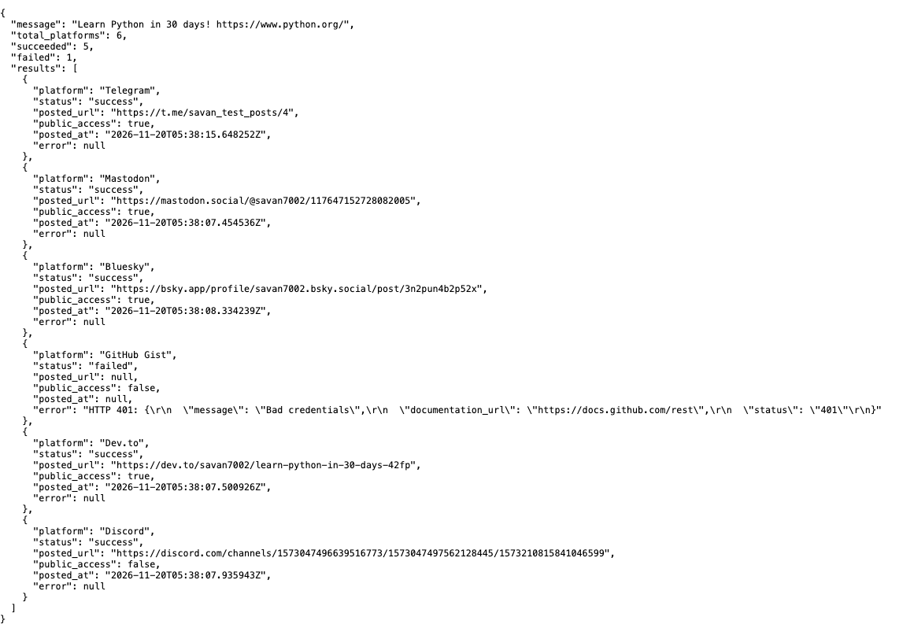

# Multi-Platform Posting API

A FastAPI service that publishes one short message (max 200 characters, exactly one CTA link) to **6 platforms at once**: Telegram, Mastodon, Bluesky, GitHub Gist, Dev.to and Discord. Each platform is handled on its own, so if one fails the others still post.

## Features
- `POST /posting` validates the message, then posts to every platform **concurrently** (`asyncio.gather`)
- Validation: max 200 characters, exactly one CTA link, valid URL, with clear 422 errors
- Per-platform result: platform, status, posted URL, public access, posting time and error
- Failures are isolated: a bad token, timeout or API error on one platform never stops the rest
- Credentials only from environment variables (`.env`)
- `GET /health` shows which platforms are configured
- Swagger docs at `/docs`, plus pytest tests

## Platforms
| Platform | API | Auth | Public |
|---|---|---|---|
| Telegram | Bot API `sendMessage` | Bot token | Yes |
| Mastodon | `POST /api/v1/statuses` | Bearer token | Yes |
| Bluesky | AT Protocol `createSession` + `createRecord` | App password, then JWT | Yes |
| GitHub Gist | `POST /gists` | Personal access token (gist scope) | Yes |
| Dev.to | `POST /api/articles` | `api-key` header | Yes |
| Discord | Webhook | Webhook URL | No (server members only) |

X/Twitter (paid API), LinkedIn and Meta (app review) and Reddit (API approval) were left out because they can't be used without paid access or approval.

## Project structure
```
app/
  main.py               # FastAPI app, routes, validation error handler
  schemas.py            # Request/response models and validation rules
  config.py             # Settings from environment / .env
  platforms/
    base.py             # BasePlatform: shared error handling (template method)
    telegram.py  mastodon.py  bluesky.py  github_gist.py  devto.py  discord.py
  services/
    posting_service.py  # Runs all platforms concurrently
tests/test_posting.py   # Validation and failure-isolation tests
```

**Design:** every platform extends `BasePlatform` and implements only `is_configured()` and `publish()`. `BasePlatform.post()` turns any error into a `failed` result, so one platform can never crash the request. To add a platform, write one class and add it to `PLATFORM_CLASSES`.

## Setup
```bash
git clone https://github.com/Savan7002/<repo-name>.git
cd <repo-name>
python -m venv venv
source venv/bin/activate          # Windows: venv\Scripts\activate
pip install -r requirements.txt
cp .env.example .env              # then add your keys
```

## Run
```bash
uvicorn app.main:app --host 0.0.0.0 --port 4000
```
Open http://localhost:4000/docs

## Sample request
```bash
curl -X POST http://localhost:4000/posting \
  -H "Content-Type: application/json" \
  -d '{"message": "My multi-platform posting API is live! https://github.com/Savan7002"}'
```

## Sample response: all succeeded
<!-- paste your 6/6 JSON here -->

## Sample response: one platform failed, the others still posted
<!-- paste the 5/1 JSON (GitHub Gist 401) here -->

## Sample validation error (422)
```json
{
  "detail": "Validation failed",
  "errors": [{"field": "message", "message": "Message must contain exactly one CTA link, but 2 were found: https://a.com, https://b.com"}]
}
```

## Tests
```bash
python -m pytest -v
```

## Screenshots




## Security
- No credentials in the code or the repo; `.env` is git-ignored
- Narrow scopes: gist-only GitHub token, `write:statuses` on Mastodon, an app password on Bluesky
- The httpx request logger is set to WARNING, because some APIs put tokens in URLs